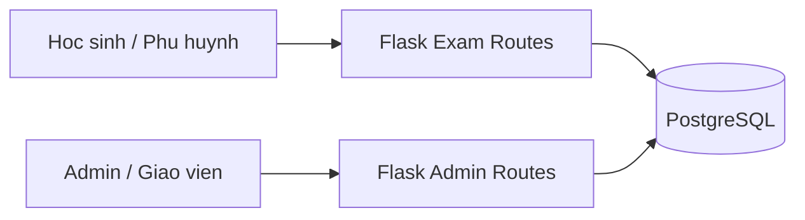
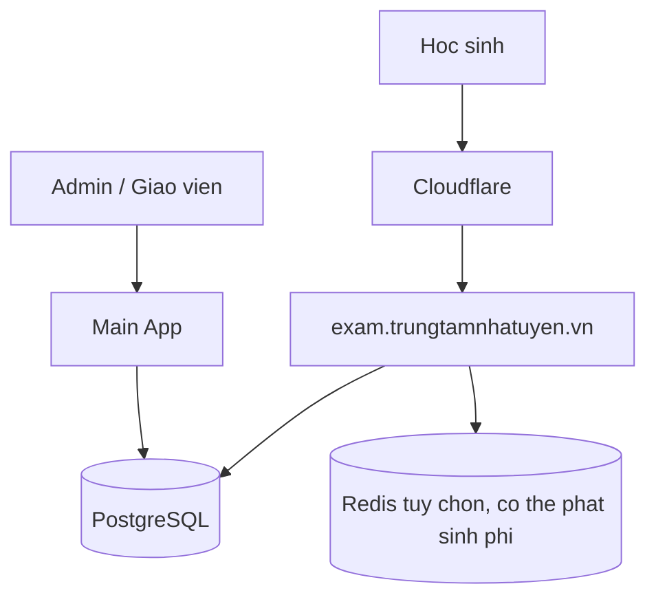

# Phuong an kien truc he thong thi online

> Phien ban free-first: uu tien su dung cac dich vu mien phi dang co, khong yeu cau Redis, Railway service thu hai, VPS, Cloudflare Tunnel hoac goi database tra phi de he thong co the van hanh.

> **CANH BAO QUAN TRONG (cap nhat 13/09/2026):** Tai lieu nay duoc viet cho quy mo vai chuc nguoi dung dong thoi (xem muc 13, Dot 2: "bat dau voi 10, 20 va 50 nguoi dung dong thoi"). Neu yeu cau thuc te la **1000 hoc sinh cung lam bai mot luc**, phan free-first cua tai lieu nay **khong dap ung duoc**, va nguyen nhan **khong phai** do truy van chua toi uu. Xem muc 3.5 moi ve mo hinh xu ly song song truoc khi dung tai lieu nay de lap ke hoach cho quy mo lon.

## 0. Gia dinh ve chi phi va gioi han

### Nut thao tac sua/xoa

- Thao tac tung dong/the dung `.action-icon-btn` 44x44px: but xanh de sua,
  thung rac do de xoa, con mat cho quyen chi xem. Moi nut co `title` va
  `aria-label`; icon trang tri co `aria-hidden="true"`.
- Nut action chi co icon tren toan website dung vien tron 50%, ke ca nut
  xem, tai xuong, doi trang thai va cac nut duoc tao dong. Nut co chu,
  phan trang va nut dong modal giu bo cuc hien tai.
- Ngoai le: chuong thong bao va mat hien/an mat khau tren trang dang nhap
  dung `.icon-action-plain`, khong nen/vien bao quanh; giu vung bam 44px
  va outline khi focus bang ban phim.
- Nut icon loc/kinh lup trong macro bo loc cung dung `.icon-action-plain`;
  nut tim kiem co chu va khung o nhap khong thay doi.
- Nut dieu huong `<`, `<<`, `>`, `>>` giu kieu Bootstrap ban dau,
  khong dung `.action-icon-btn` hay bo tron.
- Trang tai khoan Admin dung `.acct-action-btn` tron 44px dong bo
  voi nut chia khoa: but = thong tin, khien-khoa = phan quyen,
  chia khoa = mat khau, nguoi = trang thai, thung rac = xoa.
- Giu icon + chu trong menu, xoa hang loat, thao tac quan trong tren
  trang chi tiet va cac nut xac nhan. Xoa bo loc khong dung thung rac.
  Khong doi endpoint, CSRF, phan quyen hay buoc xac nhan xoa.

### Hien thi cau tim loi sai

- Nhan A/B/C/D nam ngay duoi cum tu gach chan, cac lua chon nam tren
  mot hang ben duoi cau. Soan de/xem truoc va ket qua dung cung bo cuc;
  ket qua phan biet dap an dung va dap an da chon.
- Trang lam bai co bon nut radio chi ghi A/B/C/D, khong lap cum tu.
  Nhom chon co legend, giu bon cot tren mobile va vung bam toi thieu
  44px theo chieu cao; dap an dang chon duoc to nen va khoi phuc tu ban luu.
- Khong doi cu phap `[A:...]`, `[*B:...]`, du lieu dap an hay cach cham.
  De cu co nhan E/F van duoc giu. Ban lam bai khong tiet lo dau *.

### Theo doi hoc sinh phia giao vien (27/10/2026)

- Menu duoi cung "Hoc sinh": `/teacher/students` hien cac lop dang phu trach
  va si so dang hoc. Bam lop vao `/teacher/students/class/<class_id>`,
  tim ten (escape wildcard), phan trang 20 hoc sinh, roi bam ten vao chi tiet.
  Link cu `?class_id=...` chuyen huong sang danh sach cua lop tuong ung.
- Ten hoc sinh o ca bang desktop va the mobile trong ket qua diem
  `/teacher/scores/<class_id>/detail` (va alias `/detai`) lien ket trang hoc
  tap neu GV co quyen students va hoc sinh con thuoc pham vi theo doi.
  Khong mo rong quyen cho hoc sinh da nghi/lop chi co lich day cu.
  Chi tiet co nut quay lai danh sach hoc sinh cua lop.
- Chi lay hoc sinh/dang ky/lop dang hoat dong trong lop GV dang la giao vien
  chinh hoac tro giang. Lich day cu khong cap quyen xem ho so; student/class ID
  ngoai pham vi tra 404. Trang chi ho tro GET, khong sua ho so hay du lieu hoc.
- Trang `/teacher/students/<id>` chi nhan projection ten/khoi/lop va du lieu
  hoc tap, khong truyen Student ORM, ten/SDT phu huynh, dia chi, ngay sinh,
  tai khoan, ghi chu ca nhan, hoc phi hay cong no sang template.
- Quyen `students` dieu khien menu/trang; tung muc tiep tuc kiem tra quyen
  `attendance`, `scores`, `exams` tai server. Xem 50 ban ghi gan nhat moi muc:
  diem danh, diem trung tam, bai tap; chua ghi nhan khong coi la khong lam,
  diem 0 khong coi la thieu diem. Canh bao nghi dung service thang duong lich.
- Thi online chi hien de da dang do chinh GV tao va giao cho hoc sinh trong
  pham vi lop phu trach; trang thai theo luot gan nhat, cho cham hien rieng.
  Link ket qua dung man hinh hien co de tranh hien diem luu cu/sai dap an moi.
- Kiem thu: `python -m unittest test_teacher_students.TeacherStudentsTests`
  va `node test_teacher_students.js` (menu 6 muc, mobile, quyen va du lieu rieng).

### Canh bao hoc sinh nghi tren 25% so buoi trong thang (27/10/2026)

- Moi thang tinh rieng tu ngay 1 den ngay cuoi thang (ke ca thang 2,
  nam nhuan). Mau so la toan bo lich hoc thuc te cua lop trong thang,
  gom buoi tang cuong/chua diem danh/tuong lai, khong gom buoi huy.
- Canh bao khi `absence_count * 4 > monthly_sessions`, khong canh bao
  neu dung 25% (3/8 canh bao, 3/12 khong canh bao, 4/12 canh bao).
  Tu so chi tinh buoi da diem danh den ngay xem va tu ngay vao lop:
  tinh `absent` va
  `excused`, ke ca don nghi da duyet trung buoi da diem danh; khong dem
  trung don nghi/ban ghi diem danh, khong tinh `late`.
- Chi hien tren chi tiet hoc sinh cua teacher khi co quyen students va
  attendance; khong hien o dashboard, danh sach hoc sinh hay diem danh.
  Sua diem danh/lich hoc se tinh lai khi mo trang chi tiet hoc sinh.
  API luu diem danh khong tinh/tra canh bao nua.
- Chi tinh hoc sinh/dang ky con hoat dong va chua xoa. Khong tao cron,
  khong thay hoc phi, khong gui Zalo hay thong bao phu huynh tu dong.
  Kiem thu: `python -m unittest test_attendance_warnings` va
  `node test_attendance_warnings.js` (dung vi tri, text an toan va mobile).

### Popup thong bao dung chung (27/10/2026)

- Cac thong bao JavaScript dung `showMessage(text)` thay `alert()`.
  Noi dung hien thi dang text, xuong dong va co the sao chep; popup khong
  tu bien mat. Dong bang nut, Escape; nhieu thong bao duoc xep hang.
- Ham tra Promise, dung `await showMessage(text)` neu phai cho dong popup
  truoc khi dieu huong/nop bai. Luong tu nop bai danh dau da nop va dong
  bang upload truoc khi cho, tranh nop lap khi timer tiep tuc chay.
- Xac nhan dung `await showConfirm(text)` tra boolean; Dong y moi tiep tuc,
  Huy/X/Escape tra false, mac dinh focus Huy. Cung hang doi voi thong bao.
  Form dung `data-confirm` tren form/submitter hoac `confirmFormSubmit(event, text)`
  cho noi dung dong; giu validation, CSRF, submitter va chan yeu cau lap.
- Banner flash va canh bao `beforeunload` khong doi: trinh duyet khong cho
  thay popup dong tab bang dialog tuy bien. Component doc lap Bootstrap,
  tai tu base template truoc script tung trang. Kiem thu: `node test_messages.js`.

### Anh VietQR trong thong bao hoc phi (27/10/2026)

- Hai nut xuat toan bo/chua dong mo popup xem truoc ngay nhu thong bao
  ca nhan, khong tu tai tep. Popup cho doi tai khoan, sao chep va tai PNG.
  Che do chua dong an dong da thu va danh lai STT; mo toan bo hien lai
  day du. Bo chon tai khoan nam ngoai vung anh de khong lot vao PNG.
- Radio ngan hang nhom va ca nhan dung chung helper va layout gon,
  xuong dong tren mobile; trung ten ngan hang thi kem so TK/chu TK.
  Nut but dieu chinh hoc phi dung icon-action-plain, khong vien/nen tron,
  van giu vung bam va focus ban phim.
- Modal ca nhan dung body block, khong flex stretch chieu cao the anh
  theo khung cuon. The tu cao theo noi dung de vien nen va anh PNG
  bao tron thong tin hoc sinh, hoc phi, no va chuyen khoan tren mobile.
- Nha cung cap hien redirect JPG sang SVG. Proxy chi chap nhan toi da mot
  redirect sang dung URL cung host, cung tai khoan/query, chi doi duoi `.svg`.
  Khong theo redirect tuy y. SVG duoc doc bang defusedxml va dung lai voi
  danh sach tag/thuoc tinh tinh; chi cho anh PNG/JPEG nhung base64 da kiem tra,
  cam script, foreignObject, su kien, DTD/entity va tai nguyen ngoai.
  Tra dung MIME SVG kem CSP sandbox; browser rasterize khi xuat PNG.
  Can cai dependency `defusedxml==0.7.1` khi deploy. Test:
  `python -m unittest test_vietqr_image` va `node test_tuition_svg_export.js`.
- Preview va xuat/sao chep anh dung `/admin/tuition/qr-image` cung origin
  thay vi tai truc tiep tu VietQR, tranh loi khi upstream thieu header CORS.
  URL nguon duoc server ky, chi admin co quyen hoc phi hoac hoc sinh moi
  doc duoc; khong nhan URL tuy y va khong theo redirect ngoai quy tac tren.
- Timeout ket noi/doc 3/8 giay, gioi han 2 MB va 4 trieu pixel, chi nhan
  anh PNG/JPEG hop le hoac SVG tinh da dung lai an toan. Loi upstream tra 502, ghi log khong kem URL/thong tin
  tai khoan. Trinh duyet hien loi va chan xuat anh khi QR khong tai duoc.
- Ap dung cho thong bao ca nhan/nhom tren trang hoc phi va anh hoc phi
  trong ho so hoc sinh; khong thay doi tai khoan, so tien hay noi dung CK.
  VietQR van la dich vu ngoai; can mang tu server den `img.vietqr.io`.

### Chuyen nam hoc va tai su dung hoc lieu (27/10/2026)

- **MAC DINH TAT:** `ACADEMIC_ROLLOVER_ENABLED=0` (mac dinh khi khong dat).
  Nam 2026 chi chuan bi code, KHONG cai cron hoac chay chuyen nam tren data
  that. Khi den ky chuyen nam va da backup/kiem thu staging, admin moi chu
  dong dat `ACADEMIC_ROLLOVER_ENABLED=1`, deploy lai va cau hinh worker.
  Ca web POST va CLI worker deu tu choi khi tat; moc ngay 01/07 van duoc
  kiem tra doc lap sau khi bat. Khong tu dong bat theo dong ho.
- Admin tu bam **Cuon nam hoc** tu 01/07. Preview liet ke ten/khoi moi,
  lich tuan, giao vien tung buoi, so hoc sinh va loi can xu ly.
  Lop moi co ID rieng va `rolled_over_from_id`; lop/lich/diem danh/diem/
  hoa don/lan giao bai/ket qua nam cu khong bi ghi de.
- Ke thua giao vien chinh, tro giang, giao vien tung khung gio, phong,
  hoc phi, Zalo, si so, mo ta; dang ky moi giu `discount_pct` va `note`.
  Chi chuyen dang ky dang hoc. Dang ky dang hoc tro vao hoc sinh nghi/
  xoa/cho xac nhan se chan chuyen nam, khong am tham bo hoc sinh.
- Hoc sinh du dieu kien tang dung mot khoi; cap hoc doi tuong ung khi
  5 len 6 va 9 len 10. Hoc sinh/khoi 12 tot nghiep, dong lop va vo hieu
  tai khoan hoc sinh (khong khoa tai khoan phu huynh). Hoc sinh da nghi,
  xoa hoac cho xac nhan khong tu tang khoi.
- `grade_year` phai dung nam nguon; thieu/cu/di truoc se chan thao tac.
  Admin doi chieu va sua **Moc nam cua khoi lop** trong ho so hoc sinh.
  Khong gan moc hang loat theo phong doan. Lop khoi tu do/ten khong xac
  dinh khoi/ngay ngoai nam nguon cung can xu ly truoc.
- Lich ke thua lay cac khung gio tren ngay thuong ky moi nhat cua tung
  thu trong nam hoc nguon, khong lay lich truoc nam nguon hay buoi bu/huy;
  giu nhieu khung gio cung ngay. Giao vien quan ly, tro giang va giao vien
  tung buoi phai con tai khoan hoat dong; neu khong se chan de admin xu ly,
  khong tu thay nguoi. DB hien chua
  luu rieng mau lich tuan bat bien; admin phai doi chieu preview (nhat la
  lop tung bo mot thu hoc). Khong tu suy doan lich goc luc tao lop.
- Chan toan bo neu trung giao vien/phong/hoc sinh trong cac lich moi
  hoac voi buoi da co cua nam dich; khong tu bo buoi. Nam dich da tao
  nhung chua kich hoat duoc tai su dung neu ngay hop le.
- Request xac nhan chi luu `academic_rollovers` (unique nam dich).
  CLI worker `flask --app wsgi:app process-academic-rollovers` xu ly mot
  yeu cau moi lan goi, transaction toan bo va bulk insert lich theo lo 500.
  Thanh cong va du lieu duoc commit cung nhau; loi rollback het va hien
  trang thai that bai. Process chet giua chung se rollback, yeu cau van
  pending de worker chay lai. PostgreSQL dung advisory lock + table locks
  ngan worker/chinh sua dong thoi; lock timeout 5 giay. Nen chay luc it
  nguoi thao tac, theo doi trang thai va log. Khong tang Gunicorn timeout
  de giai quyet tac vu nay.
- **Can cau hinh worker tren VPS truoc khi su dung.** Vi du host Docker:

  ```cron
  * * * * * /usr/bin/docker exec my-app-running flask --app wsgi:app process-academic-rollovers >> /var/log/academic-rollover.log 2>&1
  ```

  Doi chieu `command -v docker`, ten container va quyen Docker cua user cron.
  Chay thu lenh (khi khong co yeu cau se bao `No pending academic rollovers.`).
  Khong tao cron trong moi web worker. Backup DB truoc lan chuyen nam dau;
  theo doi va rotate log. Chua co hoan tac tu dong sau khi thanh cong.
- Khi khoi dong, co che schema hien co them bang `academic_rollovers`,
  cot `exams.content_grade`, `students.grade_year` neu thieu; khong backfill
  khoi/nam hay doi du lieu cu. Schema update PostgreSQL duoc serialize
  bang advisory transaction lock giua cac Gunicorn worker.
- **Kho de:** `content_grade` la nhan khoi noi dung doc lap voi lop duoc
  giao. Giao vien loc trong **Dung lai de**, admin loc trong danh sach de.
  Cuon nam khong doi nhan hay chuyen de cu sang lop moi. De cu chua gan
  nhan van tim duoc o **Tat ca khoi**; admin/giao vien tu phan loai.
  Sao chep tao ban nhap doc lap, giu noi dung/dap an/thang diem/thiet lap
  tron, bo lop/truong/hoc sinh/lich mo de va thu muc gan lop cu; khong sao
  chep attempt/anh/diem. Chinh sua ban sao khong tinh lai diem de nguon.
- Hoc sinh van thay/xem ket qua va anh cua bai minh da nop sau khi lop
  cu dong; khong duoc lam lai neu khong con duoc giao de. Quyen xem lich
  su khong cho phep doc bai/anh cua hoc sinh khac. De chuyen ve nhap van an.
- **Bai tap ve nha:** tren lop moi co **Dung lai bai tap cung mon/khoi**
  tu cac lop giao vien duoc phep truy cap (ke ca lop luu lich su).
  Chi sao chep ten/ghi chu, dung ngay/ky cua lan giao moi, khong mang
  trang thai lam bai cua hoc sinh cu. `Homework` hien la so theo doi
  bai tap, chua phai kho tep bai tap. Khong giao bai moi vao lop da dong.
- Kiem thu: `python -m unittest test_academic_rollover test_exam_reuse`.
  Suite dung SQLite co lap; kiem thu lock dong thoi thuc te tren PostgreSQL
  staging van can truoc lan chuyen nam production dau tien.

### Anh bai lam tu luan (cap nhat 24/10/2026)

- Hoc sinh/phu huynh co the nhap chu, tai anh, hoac ket hop ca hai.
  Moi cau toi da 3 anh, moi luot lam toi da 10 anh. Client tinh ca anh
  dang cho tai va anh tai loi cho xu ly vao gioi han; bo thao tac loi se
  giai phong cho trong.
- Trinh duyet thu nho canh dai ve 2000 px va nen JPEG truoc khi gui.
  Server chi nhan JPEG/PNG/WebP tinh, giai ma va ma hoa lai thanh JPEG,
  loai metadata; anh goc toi da 10 MB/20 trieu pixel, anh luu toi da 1 MB
  (chua tinh thumbnail). HEIC/SVG/GIF va anh dong khong duoc chap nhan.
- Gioi han moi hoc sinh: 50 lan tai/60 phut, 100 MB anh dang luu
  (bao gom thumbnail va anh da xoa nhung chua don). Gioi han ap dung ca
  cac luot lam lai khong gioi han.
- Dat `ESSAY_IMAGE_FOLDER` thanh duong dan tuyet doi tren volume ben vung,
  vi du `/data/exam-images`, va mount volume nay vao container. Mac dinh:
  `instance/exam-images` trong thu muc du an. Khong de Nginx/public route
  phuc vu thu muc nay. Backup ca database va thu muc anh; moi worker/instance
  phai dung chung storage. Khong luu tren writable layer tam cua container.
- Bang `essay_images` duoc tao khi khoi dong theo co che schema hien co.
  Anh chi duoc doc qua route dang nhap, kiem tra quyen tren dung bai lam.
  Anh khong duoc sua/xoa sau khi nop hoac het gio. CSRF ap dung cho cac
  thao tac thay doi; anh phuc vu voi `private, no-store` va `nosniff`.
- API upload: `POST /exam/attempt/<attempt_id>/upload-essay-image`,
  multipart gom `answer_field` (vi du `g0_q1`) va `image`, kem CSRF token.
  API doc: `GET /exam/essay-image/<image_id>`; `?thumbnail=1` de doc anh nho.
  ID anh la UUID hex 32 ky tu (khong phai so nguyen). Cac route cu
  `/exam-images/attempts/<attempt_id>` va `/exam-images/<image_id>` van hoat dong
  va dung chung kiem tra quyen/quota, khong can chuyen doi du lieu.
  Hoc sinh va phu huynh chi doc bai duoc phep truy cap; giao vien chi doc
  bai da nop cua de minh tao; admin can quyen module de thi.
- Dat lich chay hang ngay trong moi truong ung dung:
  `flask --app wsgi:app cleanup-essay-images`.
  Lenh don anh da xoa tren 1 gio, anh cua luot dang do tren 7 ngay, file mo coi tren
  24 gio (vi du sau khi reset luot lam). Khong tu dong xoa anh bai da nop.
  Theo doi dung luong dia, backup va log loi; can chinh sach luu tru rieng
  neu muon xoa anh bai da nop sau mot hoc ky.
- Vi du cron tren VPS chay Docker (chay `crontab -e` tren host, thay
  `TEN_CONTAINER` bang ten container ung dung dang chay):

  ```cron
  15 3 * * * /usr/bin/docker exec TEN_CONTAINER flask --app wsgi:app cleanup-essay-images >> /var/log/essay-image-cleanup.log 2>&1
  ```

  Kiem tra duong dan Docker bang `command -v docker` va chay thu lenh
  `docker exec TEN_CONTAINER flask --app wsgi:app cleanup-essay-images`
  truoc khi them cron. Container phai co bien moi truong database/storage
  dung va volume anh ben vung. Cron su dung mui gio cua host. Log can duoc
  xoay vong va giam sat exit code; loi xoa file/DB khong duoc coi la thanh cong.
- Anh tai loi co nut thu lai/bo thao tac; chan nop thu cong khi dang tai
  hoac con loi. Khi het gio, server chi giu anh da luu truoc han/nop bai.
  Chon/chup anh khong bi tinh la roi man hinh trong cua so chon anh
  (toi da 120 giay); dong ho lam bai van chay. Dong cua so chon anh bang
  chon file/huy se ket thuc mien tru. Neu van o ngoai trang sau 120 giay,
  luong chong gian lan se ghi nhan roi man hinh nhu binh thuong.

Tai lieu nay gia dinh:

- Ung dung chay tren mot Railway service trong quota/credit mien phi hien co.
- Database dung goi mien phi hien tai cua Supabase hoac PostgreSQL dang co.
- Khong co Redis managed, worker rieng, VPS rieng hay queue service.
- Cache cap ung dung chi dung bo nho cua process va khong duoc xem la noi luu du lieu chinh.
- Dung localStorage/sessionStorage o trinh duyet cho autosave tam thoi.
- Chi dung mot domain hien tai; subdomain thi rieng la tuy chon tuong lai.

Cac goi mien phi co the co quota, gioi han dung luong, gioi han ket noi, cold start, sleep khi khong co traffic va khong co SLA. Can kiem tra bang gia va quota thuc te cua Railway, Supabase va Cloudflare truoc moi dot trien khai vi cac chinh sach co the thay doi.

Khong nen cam ket mot moc response time co dinh tren free tier. Muc tieu uu tien la giam truy van thua, tranh request tang theo so luong de va giu he thong van dung duoc khi service vua wake up.

## 1. Muc tieu

Xay dung luong thi online cho hoc sinh theo mo hinh:

- Quan tri vien/giao vien tao de tai trang quan tri.
- Giao de cho mot lop hoac mot hoc sinh cu the.
- Hoc sinh xem dung cac de duoc giao.
- Hoc sinh lam bai, tu dong luu tien do va nop bai.
- Giao vien xem ket qua theo hoc sinh.
- He thong khong lam cham cac chuc nang quan ly hien tai.

Phuong an khuyen nghi la **giu ung dung Flask hien tai trong giai doan dau, sua lai mo hinh giao de va toi uu truy van truoc; chi tach dich vu thi rieng khi co so lieu tai thuc te cho thay can thiet**.

## 2. Hien trang va diem nghen

Hien tai luong de thi da co san trong he thong. Tuy nhien, cach lay danh sach de cua hoc sinh co mot so van de:

- Lay toan bo de da xuat ban roi moi loc trong Python.
- Truong `class_ids` dang luu danh sach lop duoi dang chuoi, khong phai quan he database.
- Moi de lai truy van rieng lich su `ExamAttempt` cua hoc sinh.
- Trang ket qua dang lay nhieu attempt roi gom nhom trong Python.

Mo hinh nay co the chay duoc khi du lieu it, nhung se cham dan khi so luong de, lop va hoc sinh tang.

### Van de can giai quyet

```text
Lay tat ca de
    -> Loc lop trong Python
        -> Moi de truy van lich su lam bai
            -> Tao danh sach hien thi
```

Phuong an moi can chuyen thanh:

```text
Lay cac assignment cua hoc sinh bang SQL
    -> JOIN sang de thi
        -> Truy van tong hop attempt mot lan
            -> Tao danh sach hien thi
```

## 3. Kien truc tong the

### Giai doan 1: dung chung ung dung hien tai



Trong giai doan nay:

- Trang tao de van o `/admin/exam`.
- Giao vien va quan tri vien van dung he thong phan quyen hien tai.
- Phan lam bai co the dat trong mot nhom route rieng, vi du `/exam/...`.
- Khong tao mot ung dung frontend va backend hoan toan moi neu chua can thiet.
- Khong them Redis, queue hoac worker nen neu chua co nhu cau do duoc.
- Neu process bi restart, cache trong bo nho mat di; du lieu de thi, assignment va bai lam van phai nam trong database.

### Giai doan 2: tach dich vu thi khi co tai cao



Dich vu thi rieng khong nam trong pham vi van hanh mien phi co ban. Chi xem xet khi da do duoc luong truy cap dong thoi va xac nhan mot Railway service duy nhat khong dap ung duoc. Khi do can tinh them chi phi service, database, cache va domain; khong tach service chi de giai quyet mot truy van chua toi uu.

## 3.5. Mo hinh xu ly song song (phan quyet dinh kha nang chiu tai)

> Muc nay duoc bo sung ngay 13/09/2026 sau khi do trang thai thuc te cua he thong. Day la yeu to quyet dinh so nguoi dung dong thoi, va **khong** duoc giai quyet bang viec toi uu truy van.

### Phan biet hai khai niem hay bi nham lan

| Khai niem | Y nghia | Cach cai thien |
|---|---|---|
| Chi phi moi request | Mot request ton bao nhieu query, bao nhieu ms | Toi uu SQL, them index, bo N+1 (muc 4, 6, 10) |
| So request song song | Bao nhieu request duoc xu ly **cung mot luc** | Doi worker class, tang worker, tang ha tang |

Toan bo muc 4, 6 va 10 cua tai lieu nay chi giai quyet cot thu nhat. Neu 1000 hoc sinh vao cung luc, cot thu hai moi la diem nghen.

### Trang thai da xac minh cua he thong (13/09/2026)

```text
Procfile:  gunicorn wsgi:app --workers 2
Log khoi dong gunicorn: "Using worker: sync"
config.py (production): pool_size=5, max_overflow=10
```

Worker kieu `sync` xu ly **dung 1 request tai mot thoi diem**. Vay nang luc song song thuc te:

```text
2 worker x 1 request = 2 request song song
```

Voi thoi gian xu ly khoang 200ms moi request, thong luong toi da khoang **10 request/giay**.

### Phep tinh cho 1000 hoc sinh cung mo de

```text
1000 request / 10 request moi giay = 100 giay de xu ly het hang doi
gunicorn timeout mac dinh              = 30 giay
=> Khoang 700 hoc sinh cuoi hang bi timeout / loi 502
=> Worker bi kill va restart giua chung
```

Ket qua khong phai "cham" ma la "sap". Tang `pool_size` hay them index deu khong thay doi con so 2 request song song.

### Phep tinh cho autosave (nguy hiem hon luc mo de)

Muc 8 de xuat autosave moi 20-30 giay. Voi 1000 hoc sinh:

```text
1000 hoc sinh / 25 giay = 40 request/giay LIEN TUC
Nang luc hien tai        = ~10 request/giay
=> Qua tai 4 lan, keo dai suot 15-45 phut lam bai
```

Autosave la dung ve nghiep vu (chong mat bai), nhung o quy mo 1000 user tren ha tang hien tai thi chinh no la thu lam sap he thong. Xem muc 8 da duoc cap nhat de giam tai.

### Cac buoc bat buoc de chiu duoc tai lon

Theo thu tu uu tien, tu re den dat:

**1. Chia ca thi (re nhat, hieu qua nhat, khong can code)**

Khong cho 1000 hoc sinh bat dau dung cung mot giay. Chia theo lop/khoi cach nhau 5-10 phut bien "1000 dong thoi" thanh "150-200 dong thoi", giam yeu cau ha tang khoang 5 lan ma khong sua mot dong code nao. Day la bien phap nen ap dung truoc tien trong moi truong hop.

**2. Doi worker sang kieu bat dong bo (thay doi 1 dong, hieu qua lon nhat ve ky thuat)**

```text
web: gunicorn wsgi:app --worker-class gevent --workers 4 --worker-connections 1000
```

Worker `sync` ngoi cho database thi lang phi ca tien trinh. Worker `gevent` trong luc cho I/O co the phuc vu hang tram ket noi khac.

Dieu kien di kem:

- Them `gevent` vao `requirements.txt`.
- Kiem thu ky: mot so thu vien dong bo khong tuong thich voi gevent monkey-patching.
- Phai do lai tai sau khi doi, khong mac dinh la da xong.

**3. Danh gia lai gioi han ket noi cua database**

Voi 2 worker hien tai, so ket noi toi da da la `2 x (5 + 10) = 30`. Neu tang worker len 4, con so nay thanh 60 va nhieu kha nang vuot gioi han goi Supabase mien phi. Khi tang worker **phai** giam `pool_size` moi worker tuong ung, hoac chuyen sang pooler che do transaction, hoac nang goi database. Xem them canh bao o muc 10.

**4. Do tai that truoc ngay thi (bat buoc)**

Dung `locust` hoac `k6` mo phong 50 -> 100 -> 300 -> 1000 user. **Khong duoc** to chuc thi 1000 nguoi khi chua tung do. Ghi lai: thoi gian phan hoi trung binh, ty le loi, so worker bi kill, so loi ket noi database.

### Ket luan muc nay

- Thiet ke database trong tai lieu (muc 4, 5, 6): **dung va nen lam**, bat ke quy mo.
- Chay 1000 user dong thoi tren ha tang free-first nhu tai lieu gia dinh: **khong kha thi**.
- Duong di thuc te: lam Dot 1 -> chia ca thi -> doi gevent -> do tai that -> dua vao so do de quyet dinh nang goi database/ha tang.

### Cau hoi can chot truoc khi lap ke hoach ha tang

**1000 la so tai khoan dang ky, hay so nguoi bam lam bai trong cung mot phut?** Hai con so nay khac nhau 10-50 lan ve yeu cau ha tang. Neu thuc te la "1000 hoc sinh nhung chia nhieu ca, dinh cao nhat 100-150 nguoi", bai toan de hon rat nhieu va gan voi kha nang hien tai.

## 4. Mo hinh giao de moi

Khong nen tiep tuc phu thuoc vao `Exam.class_ids` dang chuoi. Can tao bang `exam_assignments`.

### Bang `exam_assignments`

| Cot | Y nghia |
|---|---|
| `id` | Khoa chinh |
| `exam_id` | De duoc giao |
| `target_type` | `class` hoac `student` |
| `class_id` | Lop duoc giao, co the rong |
| `student_id` | Hoc sinh duoc giao, co the rong |
| `assigned_by` | Nguoi giao de |
| `assigned_at` | Thoi diem giao |
| `available_from` | Thoi diem mo de |
| `available_to` | Thoi diem dong de |
| `max_attempts` | So lan duoc phep lam |
| `is_active` | Trang thai assignment |

Can them cac index:

```text
(exam_id)
(class_id, is_active)
(student_id, is_active)
(student_id, available_from, available_to)
```

### Vi du

```text
De Toan 15 phut
    - Giao cho lop 6A
    - Giao them rieng cho hoc sinh Nguyen Van A
    - Mo tu 08:00 den 09:00
    - Duoc lam toi da 1 lan
```

### Nguyen tac truy van

Khi hoc sinh mo danh sach de:

1. Xac dinh hoc sinh dang xem.
2. Lay cac assignment dang hoat dong cua hoc sinh va lop dang hoc.
3. JOIN sang bang `exams`.
4. Loc de khong phai draft.
5. Loc theo khoang thoi gian.
6. Lay trang thai attempt bang mot truy van tong hop.

Database chi tra ve cac de hoc sinh duoc phep thay, khong lay toan bo de roi loc trong Python.

## 5. Phien ban de thi

Nen tach noi dung de thi thanh phien ban bat bien de tranh thay doi ket qua sau khi giao de.

### Bang `exam_versions`

| Cot | Y nghia |
|---|---|
| `id` | Khoa chinh |
| `exam_id` | De goc |
| `version_number` | So phien ban |
| `questions_json` | Noi dung cau hoi |
| `created_at` | Thoi diem tao |
| `published_at` | Thoi diem xuat ban |

Khi giao de:

1. Tao hoac chon mot `ExamVersion` da xuat ban.
2. Assignment tro den phien ban do.
3. Hoc sinh lam bai tren dung phien ban da giao.
4. Neu giao vien sua de sau do, bai da giao khong bi thay doi.

`ExamAttempt` nen luu `exam_version_id` de co the truy vet chinh xac hoc sinh da lam phien ban nao.

## 6. Toi uu danh sach de hoc sinh

Route danh sach de can duoc sua theo cac nguyen tac:

- Khong dung `.all()` tren toan bo bang `Exam`.
- Khong dung `exam.class_list` de loc trong Python.
- Khong truy van `ExamAttempt` rieng cho tung de.
- Dung mot truy van `GROUP BY` hoac truy van tong hop de lay:
  - So lan da nop.
  - Lan nop gan nhat.
  - Lan dang lam.
  - Diem gan nhat.
- Phan trang o database.
- Chi tai noi dung cau hoi day du khi hoc sinh bat dau lam bai.

Danh sach de chi can tai metadata:

```text
Tieu de
Mon hoc
Loai bai kiem tra
Thoi gian lam bai
Han mo/dong
Trang thai
So luot da lam
```

Khong can tai `questions_json` day du cho tat ca de trong trang danh sach.

## 7. Luong lam bai

### Bat dau lam bai

1. Kiem tra hoc sinh co assignment hop le.
2. Kiem tra de dang mo va chua het so luot.
3. Tao `ExamAttempt` neu chua co lan dang lam.
4. Tao thu tu cau hoi va dap an neu co tron cau hoi.
5. Luu thoi diem bat dau phia server.
6. Tra ve noi dung cau hoi khong chua dap an dung.

### Dang lam bai

- Hien thi dong ho dua tren thoi gian server.
- Luu dap an tam tren trinh duyet.
- Gui phan thay doi len server moi 20-30 giay.
- Gui autosave ngay khi hoc sinh chuyen cau neu can thiet.
- Khi mat mang, hien thi ro trang thai chua dong bo.
- Khi mo lai trang, tiep tuc lan lam bai dang do.

### Nop bai

1. Server kiem tra attempt hop le.
2. Server kiem tra thoi gian.
3. Server nhan dap an cuoi cung.
4. Cham diem o server.
5. Luu ket qua va thoi diem nop.
6. Khoa attempt, khong cho sua tiep.

Khong nen chi dua vao JavaScript de gioi han thoi gian. Thoi gian va trang thai cuoi cung phai duoc kiem tra phia server.

## 8. Autosave

Co the dung luong sau:

```text
Hoc sinh chon dap an
    -> Luu vao bo nho trinh duyet
    -> Debounce 20-30 giay
    -> POST /exam/attempt/<id>/autosave
    -> Server luu answers_json va updated_at
```

### Quy tac giam tai khi so hoc sinh dong thoi lon

Autosave co dinh 25 giay cho 1000 hoc sinh tao ra ~40 request/giay lien tuc (xem phep tinh o muc 3.5). Ba quy tac sau giam tai dang ke ma khong mat tinh nang chong mat bai:

**1. Chi gui khi co thay doi that**

Neu hoc sinh khong doi dap an nao ke tu lan gui truoc thi khong gui. Hoc sinh doc de, suy nghi hoac lam bai tu luan dai co the khong thay doi gi trong nhieu phut. Quy tac nay thuong cat duoc phan lon request thua.

**2. Them do lech ngau nhien (jitter)**

Khong dung dung 25 giay cho moi may. Dung khoang ngau nhien 20-40 giay:

```text
delay = 20 + random(0, 20) giay
```

Neu khong co jitter, 1000 may mo de cung luc se autosave gan nhu dung cung mot giay, tao ra dinh tai 1000 request trong 1 giay thay vi trai deu. Day la loi kinh dien khi thiet ke autosave hang loat.

**3. Cho phep server ha tan suat khi qua tai**

Server co the tra ve trong response autosave mot goi y chu ky moi (vi du `next_interval: 60`), de khi tai cao thi client tu gian ra. Day la co che don gian, khong can them dich vu nao.

### Danh doi can chap nhan

Gian autosave ra nghia la neu mat mang dot ngot, hoc sinh co the mat nhieu dap an hon. Bu lai bang cach luu vao `localStorage` moi lan doi dap an (tuc thi, khong ton request) va khoi phuc tu do khi mo lai trang. Du lieu cuoi cung van phai nam o server khi nop bai.

Can co cac endpoint:

```text
POST /exam/attempt/<id>/autosave
POST /exam/attempt/<id>/submit
GET  /exam/attempt/<id>/status
```

Nen luu them:

```text
last_saved_at
last_client_sync_at
```

De hien thi trang thai:

```text
Dang luu...
Da dong bo luc 10:32:15
Chua dong bo, vui long kiem tra ket noi
```

## 9. Anti-cheat va an toan

Khong nen xem cac bien phap chan chuot phai, F12, copy-paste la giai phap chong gian lan tuyet doi. Cac bien phap nay co the bi vuot qua va gay kho su dung tren dien thoai.

Nen uu tien:

- Tron thu tu cau hoi.
- Tron thu tu dap an.
- Tao phien ban de bat bien.
- Ghi nhan thoi diem bat dau va nop bai phia server.
- Ghi nhan so lan roi tab bang Page Visibility API.
- Ghi nhan cac lan autosave va thay doi bat thuong.
- Co the danh dau attempt can kiem tra lai.
- Khong gui dap an dung xuong trinh duyet.

Neu co quy dinh tu dong xu ly khi roi tab, nen chi danh dau canh bao o lan dau va chi xem xet tu dong nop sau khi da thong bao ro cho hoc sinh.

## 10. Cache va hieu nang trong free tier

### Bat buoc truoc

- Them bang `exam_assignments`.
- Them index cho assignment.
- Them index cho `exam_attempts` theo `exam_id`, `student_id`, `status`.
- Sua truy van danh sach de sang SQL.
- Gop truy van trang thai attempt.
- Phan trang trang ket qua.
- Do thoi gian phan hoi cua cac route chinh.

### Nen lam tiep ma khong phat sinh dich vu moi

- Chi tai metadata de trong danh sach; chi tai `questions_json` khi bat dau lam bai.
- Dung cache trong bo nho process cho noi dung de da xuat ban neu luong de nho. Chap nhan cache mat khi service restart.
- Dung `selectinload` hoac `joinedload` de tranh N+1.
- Cache metadata lop, mon hoc va loai de trong mot request hoac mot process, khong coi cache la du lieu chinh.
- Khong cache ket qua ca nhan qua lau va khong cache du lieu nhay cam trong localStorage.
- Dung HTTP compression va static asset versioning neu host cho phep; khong bat cache dai han cho trang dynamic co ket qua ca nhan.

### Khong dua vao trong ban mien phi

- Redis managed.
- Background worker hoac job queue rieng.
- Tach Railway service chi cho exam.
- VPS va Cloudflare Tunnel.
- Multi-region, autoscaling hoac database replica.

### Hien tai can luu y

Cau hinh connection pool trong `config.py` da co cac tuy chon quan ly ket noi. Tren free tier, khong nen tang `pool_size`, `max_overflow` hoac so worker tuy tien vi database co gioi han ket noi. Connection pool khong the khac phuc viec lay qua nhieu dong du lieu hoac truy van lap lai. Toi uu truy van va mo hinh assignment phai lam truoc khi tang tai.

Neu database free co gioi han ket noi thap, uu tien mot Railway service voi so worker vua phai, dung pool nho va theo doi loi timeout. Khong tao nhieu process chi de giam response time tren ly thuyet, vi moi process co the mo them ket noi database.

## 11. Sao luu va van hanh voi chi phi bang 0

Free tier khong nen duoc xem la co backup va khong co downtime. Can co quy trinh toi thieu:

- Sao luu database dinh ky bang `pg_dump` tu may tinh ca nhan hoac may quan tri tin cay.
- Tai file backup ve may cuc bo va luu them mot ban tren mot dich vu luu tru mien phi khac neu chinh sach bao mat cho phep.
- Khong luu mat khau database trong file script; dung bien moi truong hoac nhap tu terminal.
- Thu khoi phuc mot ban backup tren database local it nhat moi thang.
- Khong dung database free lam noi luu duy nhat cho du lieu diem va ket qua quan trong.
- Theo doi dung luong database, so ket noi va log loi trong dashboard mien phi cua nha cung cap.
- Neu Railway service ngu hoac cold start, giao dien phai hien thi dang ket noi lai thay vi ghi mat bai.

Khong nen them job backup tu chay tren cung mot service free neu job do co the lam day quota hoac lam cham request thi. Trong giai doan dau, backup thu cong co lich ro rang an toan hon mot job chua duoc giam sat.

## 12. Lua chon dang nhap

### Giai doan dau: dung tai khoan phu huynh

```text
Phu huynh dang nhap
    -> Chon hoc sinh
        -> Xem de duoc giao
            -> Hoc sinh lam bai
```

Uu diem:

- Tai su dung co che dang nhap hien tai.
- Khong phai tao hang tram tai khoan moi.
- Phu hop voi luong parent dang co.

### Giai doan mo rong: tai khoan rieng hoc sinh

Chi nen them khi trung tam can:

- Hoc sinh tu dang nhap.
- Lam bai tai lop khong can tai khoan phu huynh.
- Theo doi lich su hoc tap rieng.
- Ho tro nhieu co so hoac nhieu trung tam.

Khong nen thay doi dong thoi ca he thong tai khoan, assignment va ha tang thi trong mot dot.

## 13. Lo trinh trien khai free-first

### Dot 1: Toi uu database va giao de

- Do thoi gian tai cac trang hien tai.
- Tao migration cho `exam_assignments`.
- Chuyen assignment theo lop cu sang bang moi.
- Them giao de rieng cho hoc sinh.
- Sua danh sach de dung SQL.
- Them index.
- Gop truy van attempt.
- Kiem tra phan quyen va tranh truy cap cheo.

### Dot 2: Hoan thien luong lam bai

- Tao route lam bai rieng.
- Hoan thien autosave.
- Khoi phuc bai dang lam.
- Tu dong nop khi server xac dinh het gio.
- Luu phien ban de.
- Hien thi trang thai dong bo.
- Ghi nhan cold start, timeout, loi ket noi va thoi gian autosave.
- Khong tao them service de vuot qua ket qua kiem thu ma chua danh gia quota.

#### Do tai (bat buoc, khong duoc bo qua)

Muc tieu do tai phai khop voi quy mo that, khong phai con so tuong trung. Neu yeu cau la 1000 hoc sinh, phai do den 1000.

```text
Dung locust hoac k6, tang dan:
  50 user   -> ghi nhan ket qua
  100 user  -> ghi nhan ket qua
  300 user  -> ghi nhan ket qua
  1000 user -> ghi nhan ket qua
```

Moi moc can ghi lai:

```text
Thoi gian phan hoi trung binh va p95
Ty le request loi (timeout, 502, 500)
So worker bi gunicorn kill vi qua timeout
So loi het ket noi database
Thoi diem he thong bat dau xuong cap
```

Con so quan trong nhat can tim la **nguong hoc sinh dong thoi ma he thong con phuc vu on dinh**. Con so do quyet dinh:

- Co can doi sang worker gevent khong (muc 3.5).
- Co can nang goi database khong.
- Phai chia bao nhieu ca thi.

Khong duoc to chuc mot dot thi that voi so luong lon hon nguong da do duoc.

### Dot 3: chi mo rong khi can thiet

Chi thuc hien khi co so lieu cho thay mot Railway service va database free khong dap ung duoc:

- Truoc tien toi uu truy van va giam payload.
- Sau do xem xet Redis hoac cache managed neu chi phi cho phep.
- Tiep theo moi xem xet Railway service rieng cho exam.
- Chi dung subdomain rieng khi co loi ich van hanh ro rang.
- Dung pooler phu hop voi loai ket noi va nha cung cap dang su dung; khong coi pooler la cach tang quota database mien phi.
- Uu tien log cua Railway, log ung dung va cac cong cu quan sat mien phi thay vi them he thong monitoring tra phi.

## 14. Tieu chi danh gia thanh cong

### Hieu nang

- Trang danh sach de co it truy van va payload nho trong dieu kien service da warm.
- Trang bat dau lam bai khong doc noi dung cua cac de khac.
- Khong co truy van theo tung de trong trang danh sach.
- So luong query moi request duoc theo doi va khong tang theo so luong de.
- Co ghi nhan rieng cold start va thoi gian phan hoi database de khong nham lan hai loai cham.

### Tinh dung dan

- Hoc sinh chi thay de duoc giao.
- Hoc sinh khong truy cap duoc de cua nguoi khac bang cach sua URL.
- Bai da nop khong bi thay doi khi giao vien sua de.
- Het gio phai duoc xu ly phia server.
- Ket qua phai gan voi dung phien ban de da lam.

### Kha nang mo rong

- Ho tro giao cho lop.
- Ho tro giao cho hoc sinh rieng.
- Ho tro nhieu assignment cho cung mot de.
- Co the tach dich vu thi ma khong phai viet lai nghiep vu cham diem.

## 15. Ket luan

Phuong an phu hop nhat la:

> Giu phan tao de trong trang quan tri hien tai, xay dung module lam bai rieng dua tren bang `exam_assignments`, toi uu truy van bang SQL, luu phien ban de va autosave; sau do moi tach dich vu `exam` rieng khi co so lieu tai thuc te.

Voi he thong chi dung tai nguyen mien phi, ban dau chi can mot ung dung Flask, mot database, browser storage va cache trong bo nho. Khong nen tach mot trang thi moi ngay tu dau neu nguyen nhan cham chua duoc do va xu ly. Diem can lam truoc la bo mo hinh `class_ids` dang chuoi, tranh lay toan bo de, tranh N+1 query va phan trang ket qua trong database.

### Bo sung 13/09/2026: pham vi ap dung cua ket luan tren

Ket luan tren **chi dung cho quy mo vai chuc nguoi dung dong thoi**, dung nhu gia dinh free-first o muc 0.

Neu yeu cau that su la **1000 hoc sinh cung lam bai**, can hieu ro:

1. **Phan thiet ke database cua tai lieu nay van dung va van nen lam truoc tien.** `exam_assignments`, `exam_versions`, bo `class_ids` dang chuoi, tranh N+1 — tat ca deu la no ky thuat that, can lam bat ke quy mo.

2. **Nhung nhung viec do khong lam tang so nguoi dung dong thoi.** He thong hien tai chi xu ly 2 request song song (muc 3.5). Toi uu truy van lam moi request nhanh hon, khong lam duoc nhieu request cung luc hon.

3. **Thu tu dung de mo rong quy mo:**

```text
Dot 1 (thiet ke DB)  -> van lam nhu tai lieu mo ta
Chia ca thi          -> re nhat, khong can code, giam tai 5 lan
Doi worker gevent    -> sua 1 dong Procfile + them thu vien
Do tai that          -> tim nguong dong thoi thuc te
Nang ha tang         -> chi khi so do chung minh la can
```

4. **Khong cam ket to chuc thi 1000 nguoi truoc khi co so lieu do tai.** Ke hoach thi phai dua tren nguong da do duoc, khong dua tren ky vong.
